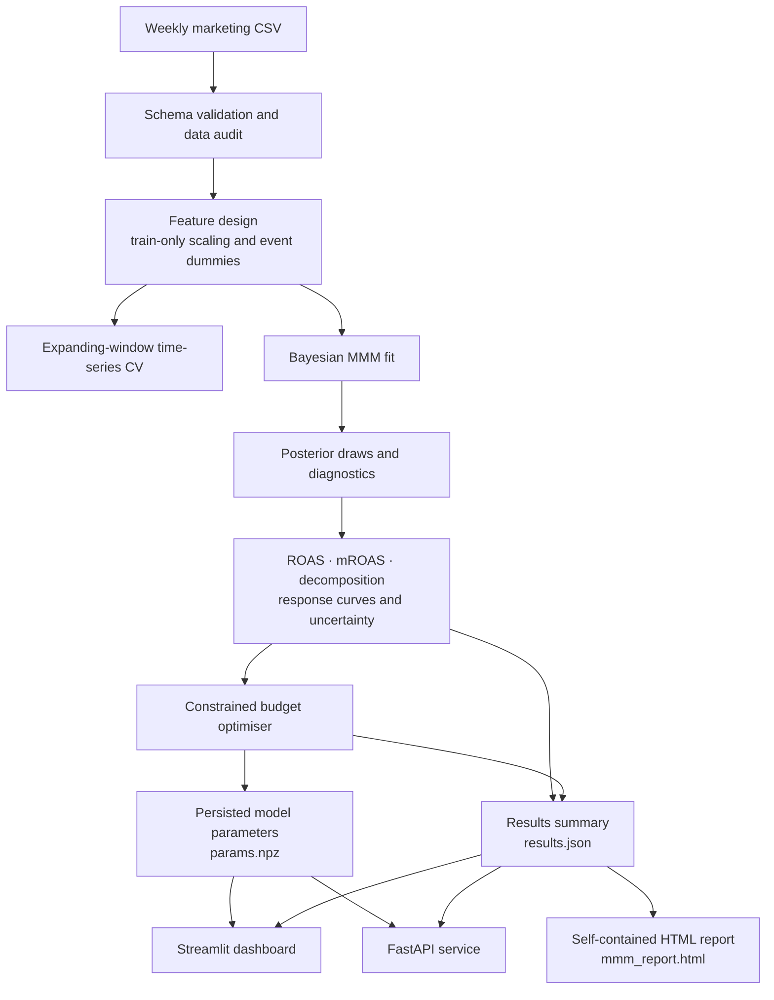

<div align="center">

# MMM Toolkit

### Bayesian Marketing Mix Modeling · Measurement · Budget Allocation

Estimate channel contribution, quantify uncertainty, and evaluate constrained weekly budget scenarios with a reproducible Python workflow.


</div>

---

## Overview

**MMM Toolkit** is a Python application for analysing weekly marketing investment using Bayesian Marketing Mix Modeling (MMM). It combines channel-level carry-over and saturation effects with non-media controls, time-series validation, posterior uncertainty, and constrained budget optimisation.

The workflow is designed to connect model estimation to practical analysis:

1. Validate and audit the input time series.
2. Evaluate out-of-sample forecasting performance with expanding-window cross-validation.
3. Fit a Bayesian MMM and inspect sampling diagnostics.
4. Estimate channel contributions, ROAS, marginal ROAS, saturation, and carry-over.
5. Compare feasible budget allocations under explicit channel-level constraints.
6. Export a self-contained HTML report and serve the fitted results through a dashboard and REST API.

> **Intended use:** analytical decision support and scenario exploration. The model uses observational time-series data; its channel estimates should not be interpreted as experimentally identified causal effects unless supported by suitable experiments.

## Product architecture



### Main components

| Component | Responsibility | Primary modules |
|---|---|---|
| Data layer | CSV loading, schema checks, quality and identifiability audit, design-matrix preparation | `mmm/data.py` |
| Model layer | Bayesian MMM construction, inference and optional lift-test calibration | `mmm/model.py` |
| Diagnostics | Convergence, fit, residual diagnostics, expanding-window CV and scorecard | `mmm/diagnostics.py` |
| Posterior analytics | Channel contributions, ROAS, mROAS, response curves and decomposition | `mmm/analysis.py` |
| Optimisation | Posterior response evaluation and constrained allocation | `mmm/optimize.py` |
| Reporting | Executive narrative, tables and embedded charts | `mmm/report.py` |
| Orchestration | End-to-end pipeline, artifact persistence and CLI | `mmm/pipeline.py` |
| User interfaces | Interactive analysis and HTTP endpoints | `app.py`, `api.py` |

## Methodology

### 1. Model specification

The model represents revenue as a combination of baseline demand, media response, seasonality, trend, and observed controls. For channel \(c\), weekly spend is transformed through geometric adstock and logistic saturation before contributing to the target.

A simplified channel-response expression is:

\[
\text{Contribution}_{c,t}
= \beta_c\,\tanh\left(\frac{\lambda_c\,a_{c,t}}{2}\right)
\]

where:

- \(a_{c,t}\) is the normalised geometric-adstock transformation of channel spend;
- \(\beta_c\) controls the channel's response magnitude;
- \(\lambda_c\) controls the shape of the saturation curve.

The expression is shown in the model's scaled target space; reported channel contributions are converted back to the original revenue scale using the fitted target scale.

The implementation uses `pymc-marketing` with:

- **Geometric adstock**, with an eight-week lag window by default;
- **Logistic saturation** for diminishing returns;
- **Fourier yearly seasonality**, order 2 by default;
- **Standardised continuous controls**, using statistics learned from the training window;
- **Event indicators** generated from the configured categorical event column;
- **A linear time trend**, enabled by default;
- **Spend-aware HalfNormal priors** for channel saturation effects and Normal priors for control coefficients.

The adstock and saturation components use the configured `pymc-marketing` components. Their parameter priors are not separately overridden in the project code; consult the installed library version when documenting their exact distributions.

### 2. Posterior-based channel measurement

The toolkit derives channel metrics from posterior draws rather than reporting only point estimates.

| Metric | Interpretation in this project |
|---|---|
| Incremental revenue | Estimated media contribution over the observed period |
| ROAS | Estimated incremental revenue divided by observed channel spend |
| Marginal ROAS | Estimated incremental revenue from the next unit of spend at the channel's average weekly spend |
| Saturation | Position on the fitted channel response curve at average weekly spend |
| Carry-over half-life | Number of weeks for an adstock impulse to lose half of its weight |
| Probability of profitability | Posterior share of ROAS draws above the configured revenue break-even threshold |
| Response curve | Posterior expected weekly incremental revenue across a range of constant weekly spend levels |

The default interval width is **90%**. The default `breakeven_roas` is `1.0`; this should be configured to reflect the business's unit economics. These are revenue-based ROAS calculations, not profit calculations.

### 3. Budget optimisation

The optimiser evaluates constant weekly spend by channel under a steady-state response assumption. It uses posterior response draws and SciPy's SLSQP optimiser to solve a constrained allocation problem.

The objective is to maximise posterior expected incremental revenue, optionally penalised by posterior uncertainty:

\[
\max_{x}\quad \mathbb{E}[R(x)] - \rho\,\operatorname{SD}[R(x)]
\]

subject to:

\[
\sum_c x_c = B,\qquad
m_{\min}\bar{x}_c \le x_c \le m_{\max}\bar{x}_c
\]

where \(B\) is the requested total weekly budget, \(\bar{x}_c\) is historical average weekly spend, and \(\rho\) is the risk-aversion setting.

Default bounds are **50%–200% of each channel's historical average weekly spend**. Budgets outside the aggregate feasible range are rejected rather than extrapolated. The reported uplift is compared with the current channel mix scaled proportionally to the selected total budget.

The returned result includes the recommended channel allocation, percentage changes, marginal ROAS before and after reallocation, whether channels are at a bound, the posterior uplift interval, and the probability that uplift is positive. Always inspect the optimiser's `converged` field before using a recommendation.

## Data contract

The default configuration expects one row per week and the following columns:

| Column | Role | Default name | Requirements |
|---|---|---|---|
| Date | Time index | `DATE` | Parseable dates; unique values |
| Target | Outcome | `revenue` | Numeric and non-negative |
| Media spend | Channel inputs | `tv_S`, `ooh_S`, `print_S`, `facebook_S`, `search_S` | Numeric and non-negative; missing spend is filled with zero |
| Continuous controls | Non-media predictors | `competitor_sales_B`, `newsletter` | Numeric and non-null |
| Events | Optional categorical input | `events` | Converted to event dummy columns when configured |

The schema is permissive of additional columns, but only configured columns enter the model. Customer counts are deliberately not included in the default controls because they may be downstream outcomes of marketing activity.

### Data preparation and audit

The audit reports:

- date range, row count and whether observations form a regular seven-day grid;
- channel spend share and zero-spend share;
- highly correlated media pairs (absolute correlation above 0.70);
- variance inflation factors from the channel correlation matrix;
- robust target outlier weeks;
- observations per approximate model parameter.

For cross-validation, continuous-control means and standard deviations, event columns, and trend scaling are learned on each training fold and then reused unchanged on its hold-out fold. This is intended to prevent preprocessing leakage across time splits.

### Example dataset

The notebook downloads `dt_simulated_weekly.csv` from the Meta Robyn tutorial resources. The saved example run contains **208 weekly observations from 2015-11-23 through 2019-11-11**. It is simulated tutorial data, not a real advertiser dataset or evidence of live business performance.

The CSV is excluded by the repository's `data/*.csv` ignore rule, so download it after cloning:

```powershell
New-Item -ItemType Directory -Force data | Out-Null
Invoke-WebRequest `
  -Uri "https://raw.githubusercontent.com/facebookexperimental/Robyn/main/python/src/robyn/tutorials/resources/dt_simulated_weekly.csv" `
  -OutFile "data/dt_simulated_weekly.csv"
```

For a business dataset, provide a CSV that follows the configured schema and set the column names in `mmm/config.py`.

## Installation

### Requirements

- Python **3.11 or later** (Python 3.12 is used in the Docker image and CI workflow)
- pip
- The dataset described above, or a compatible weekly marketing dataset

### Install the project

From the repository root:

```bash
python -m venv .venv
```

Activate the environment, then install the package and optional application dependencies:

```bash
# Windows PowerShell
.\.venv\Scripts\Activate.ps1

# macOS / Linux
source .venv/bin/activate

python -m pip install --upgrade pip
pip install -e ".[dev,api,dashboard]"
```

To enable MLflow tracking as well:

```bash
pip install -e ".[dev,api,dashboard,tracking]"
```

## Run the pipeline

The `mmm-run` command executes the analysis pipeline and writes the fitted parameters, machine-readable summary, and HTML report to `artifacts/` by default.

```bash
mmm-run
```

Explicit paths can be supplied:

```bash
mmm-run --data data/dt_simulated_weekly.csv --out artifacts
```

### CLI options

| Option | Description |
|---|---|
| `--data PATH` | Input CSV; defaults to `MMM_DATA_PATH` or `data/dt_simulated_weekly.csv` |
| `--out PATH` | Artifact directory; defaults to `MMM_ARTIFACTS_DIR` or `artifacts/` |
| `--lift-tests PATH` | CSV of experimental lift measurements used to calibrate the model before fitting |
| `--skip-cv` | Skip expanding-window cross-validation; reduces run time but removes the out-of-sample comparison |
| `--mlflow` | Log configuration, selected metrics and artifacts to MLflow; requires the `tracking` extra |

`--robustness` is intentionally not presented as a supported analytical workflow: the current `prior_sensitivity()` implementation returns random placeholder values rather than fitting alternative prior specifications. Do not use its output for model assessment.

### Optional lift-test calibration

The model layer can ingest experimental measurements before fitting. The CSV schema is:

| Field | Meaning |
|---|---|
| `channel` | Configured media channel name |
| `x` | Baseline spend at the experiment reference point |
| `delta_x` | Change in spend during the experiment |
| `delta_y` | Observed change in revenue |
| `sigma` | Standard error of the observed revenue change |

Example invocation:

```bash
mmm-run --lift-tests data/lift_tests.example.csv
```

The included example file is a schema illustration. Replace its values with properly designed and analysed experimental results before using lift-test calibration for a business decision.

## Generated artifacts

A successful pipeline run creates:

| File | Contents | Used by |
|---|---|---|
| `artifacts/params.npz` | Posterior parameter draws and channel metadata required for response evaluation | Optimiser, dashboard and API |
| `artifacts/results.json` | Model verdict, diagnostics, ROAS table, decomposition, optimisation and CV summaries | Dashboard and API |
| `artifacts/mmm_report.html` | Self-contained executive report with embedded charts and tables | Browser, dashboard download |

The dashboard and API require a completed pipeline run. They do not fit a model when they start; they load the saved artifacts.

## Streamlit dashboard

Start the pipeline first, then launch:

```bash
streamlit run app.py
```

The dashboard contains five tabs:

1. **Channel efficiency** — fit metrics, ROAS, marginal ROAS, saturation, half-life and revenue decomposition.
2. **Budget optimiser** — total-budget and channel-bound controls, risk aversion, recommended allocation and custom-plan evaluation.
3. **Response curves** — channel-level response curves with posterior intervals.
4. **Model health** — scorecard, cross-validation output and data audit.
5. **Report** — download the generated HTML report.

The custom-plan evaluator is a scenario tool; it should not be treated as a substitute for checking whether a plan remains inside the optimiser's supported spend range.

## REST API

Launch the service after generating artifacts:

```bash
uvicorn api:app --host 127.0.0.1 --port 8000
```

Interactive API documentation is exposed by FastAPI at `/docs` while the service is running.

| Method | Endpoint | Purpose |
|---|---|---|
| `GET` | `/health` | Service status and whether fitted parameters are present |
| `GET` | `/summary` | Verdict, fit summary and channel ROAS results |
| `POST` | `/optimize` | Compute an allocation from the saved posterior parameters |

Example request using the saved model's default total budget:

```bash
curl -X POST "http://127.0.0.1:8000/optimize" \
  -H "Content-Type: application/json" \
  -d "{}"
```

`/optimize` accepts an optional `total_budget`, `min_mult`, `max_mult`, and `risk_aversion`. Invalid or infeasible requests return HTTP `422`; missing model artifacts return HTTP `503`.

## Configuration

The default settings live in `mmm/config.py` in the `MMMConfig` model.

| Setting | Default | Description |
|---|---:|---|
| `adstock_l_max` | `8` | Number of weekly lags in geometric adstock |
| `yearly_seasonality` | `2` | Fourier order for yearly seasonality |
| `beta_prior_scale` | `0.5` | Scale factor for spend-aware channel-effect priors |
| `control_prior_sigma` | `0.5` | Standard deviation for Normal control-coefficient priors |
| `draws` | `2000` | Posterior draws per chain in the final patched configuration |
| `tune` | `2000` | Tuning iterations per chain in the final patched configuration |
| `chains` | `4` | Number of sampling chains |
| `target_accept` | `0.95` | NUTS target acceptance probability |
| `cv_folds` | `3` | Number of expanding-window validation folds |
| `cv_test_size` | `13` | Weeks in each validation window |
| `interval` | `0.90` | Posterior interval width used by analysis outputs |
| `breakeven_roas` | `1.0` | Revenue ROAS threshold used for profitability probability |
| `min_spend_mult` | `0.5` | Default lower channel spend bound vs historical average |
| `max_spend_mult` | `2.0` | Default upper channel spend bound vs historical average |
| `risk_aversion` | `0.0` | Penalty weight applied to posterior response uncertainty |

The notebook first writes a base configuration and then applies a later patch cell. The values above describe the final patched configuration used by the saved pipeline run. Keep the generated repository files in sync with that patch.

The `.env.example` file documents `MMM_DATA_PATH` and `MMM_ARTIFACTS_DIR`. The application reads these values from the process environment; it does not load `.env` automatically.

## Validation and model scorecard

The toolkit calculates several categories of diagnostics.

| Category | Implemented diagnostics |
|---|---|
| Sampling | Maximum R-hat, minimum bulk effective sample size, divergence count and divergence fraction |
| In-sample fit | R², MAPE, RMSE and posterior predictive interval coverage |
| Residuals | Durbin–Watson statistic and Ljung–Box p-value |
| Time-series CV | Expanding-window folds; MAPE and RMSE; comparison with a seasonal-naive lag-52 baseline; interval coverage and fold R-hat |
| Data quality | Spend correlation, VIF, zero-spend share, robust outlier weeks, weekly regularity and observations per approximate parameter |
| Synthetic recovery | End-to-end test using simulated data with known channel ROAS; checks contribution calculations against the fitted library output |

### What the current verdict does—and does not—mean

The current scorecard verdict is based on six checks:

| Check | Current rule |
|---|---|
| Maximum R-hat | Pass at or below `1.01` |
| Minimum bulk ESS | Pass at or above `400` |
| Divergence fraction | Pass at or below `1%` |
| In-sample R² | Pass at or above `0.85`; warning from `0.60` to below `0.85`; fail below `0.60` |
| Durbin–Watson | Pass from `1.5` through `2.5`; otherwise warning |
| Observations per approximate parameter | Pass at or above `5`; otherwise fail |

Any failed check produces `NOT RELIABLE`; warnings without failures produce `DIRECTIONAL`; and six passing checks produce `DECISION-GRADE`.

**Important implementation boundary:** cross-validation results, posterior predictive interval coverage, and the Ljung–Box p-value are calculated or reported but are not currently gates in the verdict logic. The configured `max_mape` threshold is not currently wired into the scorecard. A `DECISION-GRADE` label is therefore an internal heuristic based on the six rules above—not proof of causal validity, external validity, or business readiness.

## Tests and continuous integration

Run the tests from the repository root:

```bash
# All discovered tests, including the slow Bayesian recovery test
python -m pytest -q

# Fast tests only
python -m pytest -m "not slow" -q

# Synthetic recovery test
python -m pytest -m slow -q
```

The GitHub Actions workflow targets Python 3.12 and runs fast tests separately from the slow synthetic recovery test. The notebook's saved execution output records **24 passed**. However, the notebook's visible file-generation cells do not recreate `tests/test_analysis.py`, which accounts for eight analysis tests in that saved run. The explicitly generated test files in the notebook define 16 test functions. Commit or recreate the missing test module before treating the 24-test result as reproducible from a clean checkout.

## Docker

The provided Docker setup runs the API and dashboard as separate services. Generate the artifacts locally first, then build and start the services:

```bash
pip install -e ".[api,dashboard]"
mmm-run
docker compose up --build
```

- API: `http://localhost:8000`
- Dashboard: `http://localhost:8501`

The Compose configuration mounts the local `artifacts/` and `data/` directories into both containers. The Dockerfile starts the API by default; Compose overrides the command for the dashboard service.

## Repository structure

```text
MMM-Toolkit/
├── mmm/
│   ├── config.py          # Central configuration
│   ├── data.py            # Validation, audit and feature design
│   ├── model.py           # Bayesian model and lift-test calibration
│   ├── diagnostics.py     # Sampling, fit, residual and CV diagnostics
│   ├── analysis.py        # Posterior metrics and decomposition
│   ├── optimize.py        # Constrained allocation
│   ├── report.py          # HTML report generation
│   ├── pipeline.py        # End-to-end orchestration and CLI
│   └── simulate.py        # Synthetic data with known channel truth
├── tests/
├── data/
│   └── lift_tests.example.csv
├── artifacts/             # Generated; ignored by Git
├── app.py                 # Streamlit dashboard
├── api.py                 # FastAPI application
├── pyproject.toml
├── Dockerfile
├── docker-compose.yml
├── MODEL_CARD.md
└── README.md
```
