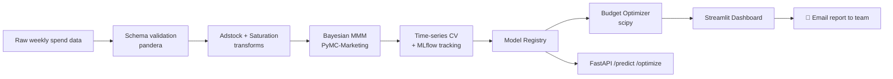

# 📊 MMM Toolkit — Bayesian Marketing Mix Modeling

[](https://github.com/Worof/mmm-toolkit/actions/workflows/ci.yml)
[](https://pypi.org/project/mmm-toolkit/)
[](https://www.python.org/)
[](LICENSE)


A production-style Bayesian Marketing Mix Model: from raw weekly spend data to a validated, cross-validated, MLflow-tracked model, a budget optimizer, a live Streamlit dashboard, and a served FastAPI endpoint — containerized and CI/CD-ready end to end.

---

## 📑 Table of Contents

- [Why This Project Exists](#-why-this-project-exists)
- [What This Project Does](#-what-this-project-does)
- [Architecture](#-architecture)
- [Visualizations](#-visualizations)
- [Install](#️-install)
- [Usage](#-usage)
- [Project Structure](#-project-structure)
- [Model Details](#-model-details)
- [Roadmap](#-roadmap)
- [License](#-license)

---

## 💡 Why This Project Exists

Every marketing team eventually hits the same wall: **spend is going up, but nobody can say with confidence which channel is actually driving revenue, or where the next dollar should go.** Marketing Mix Modeling answers exactly that — using statistical modeling (not just last-click attribution) to decompose revenue into baseline demand and each channel's true incremental contribution, accounting for the fact that media effects carry over time (**adstock**) and diminish with scale (**saturation**).

This repo is a full, professional-grade implementation of that workflow — built to mirror how a real marketing data science team would ship it, not just a one-off analysis notebook.

---

## 🎯 What This Project Does

1. **Validates** incoming weekly spend/revenue data against a strict schema — bad data fails loudly, not silently
2. **Transforms** each channel's raw spend with adstock (carryover) and saturation (diminishing returns) curves
3. **Fits** a Bayesian MMM (PyMC-Marketing) with full posterior uncertainty, not just point estimates
4. **Validates** the model with expanding-window time-series cross-validation — never trains on the future
5. **Tracks** every experiment, parameter, and metric in MLflow, with model versioning through the registry
6. **Optimizes** budget allocation across channels under a fixed spend constraint (scipy)
7. **Serves** results via a Streamlit dashboard (with one-click email reports to the team) and a FastAPI endpoint for programmatic access
8. **Ships** as a tested, CI'd, Dockerized, PyPI-published Python package — not a script that only runs on one machine

---

## 🏗 Architecture



---

## 📈 Visualizations

### Media transforms

**Adstock — how a single spend spike carries over time:**


**Adstock decay, animated — watch one spend spike carry forward week by week:**


**Saturation — diminishing returns at different response shapes:**


**Saturation curve, animated — the diminishing-returns shape built point by point:**


### Model performance

**Model fit, animated — actual vs. predicted revenue drawn week by week:**


### Business output

**Example optimized budget allocation:**


> All assets are generated locally with `python generate_assets.py` — regenerate them anytime your model or data changes, then commit the updated `assets/` folder alongside this README.

---

## ⚙️ Install

```bash
pip install -e ".[dashboard,api,dev]"
```

## 🚀 Usage

**Train the model:**
```bash
mmm-train
```

**Run tests:**
```bash
pytest tests/ -v
```

**Run the API:**
```bash
uvicorn mmm.api:app --reload
```

**Run the dashboard** (set up email first):
```bash
cp .env.example .env   # fill in SMTP credentials
streamlit run app.py
```

**Run everything in Docker:**
```bash
docker compose up --build
```

---

## 📁 Project Structure

```
mmm_project/
├── mmm/
│   ├── config.py        # typed config
│   ├── schema.py         # data validation
│   ├── transforms.py     # adstock + saturation
│   ├── features.py       # load/validate pipeline
│   ├── train.py           # CV training + MLflow tracking
│   ├── optimize.py        # budget optimizer
│   ├── notify.py           # email notifications
│   └── api.py               # FastAPI serving layer
├── tests/                # pytest suite
├── assets/                # generated charts + animations
├── app.py                  # Streamlit dashboard
├── generate_assets.py       # regenerates all README visuals
├── Dockerfile, Dockerfile.streamlit, docker-compose.yml
├── .github/workflows/     # CI + PyPI release automation
└── MODEL_CARD.md
```

---

## 🧠 Model Details

| | |
|---|---|
| **Framework** | PyMC-Marketing (Bayesian) |
| **Adstock** | Geometric decay |
| **Saturation** | Logistic (Hill) |
| **Validation** | Expanding-window time-series CV, 4 folds |
| **Tracking** | MLflow experiments + model registry |
| **Data** | Meta's open-source Robyn reference dataset (208 weeks) |

See [MODEL_CARD.md](MODEL_CARD.md) for intended use, limitations, and metrics.

---

## 🛣 Roadmap

- [ ] Wire `/predict` endpoint to the registered production model
- [ ] Add channel interaction terms
- [ ] DVC-based data versioning

---

## 📄 License

MIT — see [LICENSE](LICENSE).
