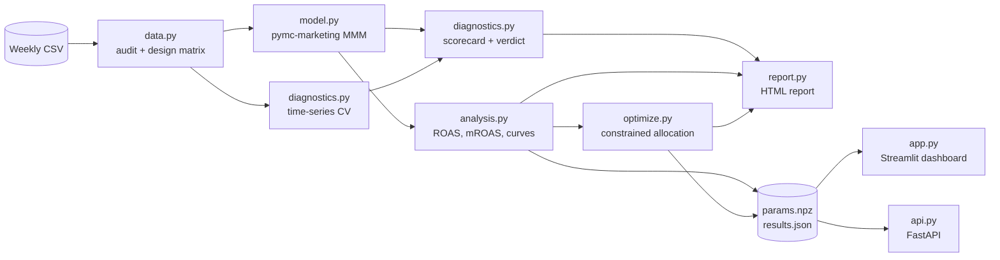

<div align="center">


<br/>


**Bayesian Marketing Mix Modeling that tells you what works, how sure it is, and where the next dollar should go.**

[Results](#-results-on-the-bundled-dataset) ·
[Quick start](#-quick-start) ·
[Dashboard](#-dashboard) ·
[API](#-rest-api) ·
[Method](#-method) ·
[Limits](#-limitations-read-this-before-acting-on-results)

</div>

---

## ✨ What you get

| | |
|---|---|
| 🔍 **Data audit** | Weekly-grid check, outlier weeks, channel correlation and VIF, zero-spend (flighting) share, observations per parameter |
| 📈 **Bayesian MMM** | Geometric adstock + logistic saturation, Fourier seasonality, trend, z-scored controls, event dummies, spend-aware priors |
| ✅ **Honest validation** | Expanding-window time-series CV against a seasonal-naive benchmark, R-hat / ESS / divergences, residual autocorrelation, interval coverage |
| 🚦 **Verdict, not vibes** | Every run ends in `DECISION-GRADE`, `DIRECTIONAL` or `NOT RELIABLE`, so nobody acts on a model that failed its checks |
| 💰 **ROAS with uncertainty** | ROAS, marginal ROAS, saturation, carry-over half-life and P(profitable) for each channel, all from posterior draws |
| 🎯 **Constrained optimiser** | Reallocates a fixed budget within per-channel bounds, optional risk aversion, and reports the probability the new mix beats the current one |
| 🧪 **Experiment calibration** | Feed geo-lift / holdout results back in to anchor the saturation curves |
| 📄 **Executive report** | One self-contained HTML file: findings first, evidence second, caveats explicit |
| 🖥️ **Dashboard + API** | Streamlit app for what-if planning, FastAPI service for integration, Docker Compose for both |

---

## 🔄 How it works

<div align="center">

</div>



The fitted posterior is reduced to a small `Params` object saved to `artifacts/params.npz`. The dashboard and API load only the saved artifacts, so they start instantly and do not import PyMC at serve time.

---

## 📊 Results on the bundled dataset

> The repo ships with Meta Robyn's **simulated** weekly dataset (208 weeks, 5 media channels), so everything below is reproducible but **illustrative, not real business results**.

### Can we trust the model?

<div align="center">

| Check | Value | Rule | Status |
|:--|--:|:--|:--:|
| Convergence (R-hat) | 1.003 | ≤ 1.01 | ✅ |
| Effective sample size | 1,845 | ≥ 400 | ✅ |
| Divergences | 0.0% | ≤ 1.0% | ✅ |
| Goodness of fit (R²) | 0.92 | ≥ 0.85 | ✅ |
| Residual autocorrelation (Durbin-Watson) | 2.03 | 1.5 to 2.5 | ✅ |
| Data richness (obs per parameter) | 8.3 | ≥ 5.0 | ✅ |

**Verdict: `DECISION-GRADE`**

</div>

Out-of-sample, the model beats a seasonal-naive forecast on every expanding-window fold (13 weeks held out each time):

| Fold | Train weeks | Model MAPE | Seasonal-naive MAPE | 90% interval coverage |
|:-:|:-:|:-:|:-:|:-:|
| 1 | 169 | 13.5% | 19.4% | 92% |
| 2 | 182 | 5.3% | 33.7% | 100% |
| 3 | 195 | 3.5% | 10.8% | 100% |
| **Mean** | | **7.4%** | **21.3%** | |

<div align="center">

<br/><sub>In-sample fit with 90% predictive interval (R² 0.92). Real output of the pipeline.</sub>
</div>

### Which channels pay back?

<div align="center">

</div>

| Channel | Spend (history) | ROAS | 90% interval | Marginal ROAS | Half-life (wk) | P(profitable) |
|:--|--:|--:|:-:|--:|--:|--:|
| `tv_S` | \$3.09M | 5.78 | 4.13 to 7.69 | 6.60 | 0.3 | 100% |
| `ooh_S` | \$8.99M | 0.72 | 0.11 to 1.48 | 0.74 | 1.1 | 25% |
| `print_S` | \$0.78M | 8.05 | 3.04 to 13.49 | 8.62 | 0.4 | 99% |
| `facebook_S` | \$0.45M | 12.99 | 2.99 to 24.71 | 13.85 | 0.4 | 99% |
| `search_S` | \$1.23M | 13.60 | 1.63 to 32.19 | 12.85 | 0.9 | 97% |

- Media drives about **14%** of revenue (9% to 20% at 90% confidence); the rest is baseline demand, seasonality and non-media factors.
- `ooh_S` takes **62%** of spend but has only a **25%** chance of beating break-even.
- `search_S` looks best but is also the **most uncertain** channel. The report says so and recommends a geo-holdout test there before a large shift.

<div align="center">

</div>

### Where should the next dollar go?

<div align="center">

</div>

At the **same total budget**, within 50% to 200% of each channel's current spend:

| Channel | Current / wk | Recommended / wk | Change | mROAS now | mROAS after |
|:--|--:|--:|--:|--:|--:|
| `tv_S` | \$14.8K | \$24.7K | +66% | 6.60 | 6.16 |
| `ooh_S` | \$43.2K | \$21.6K | −50% | 0.74 | 0.75 |
| `print_S` | \$3.7K | \$7.5K | +100% | 8.62 | 7.91 |
| `facebook_S` | \$2.1K | \$4.3K | +100% | 13.85 | 11.93 |
| `search_S` | \$5.9K | \$11.8K | +100% | 12.85 | 8.63 |

Expected incremental revenue rises from **\$283.6K to \$452.1K per week**: a gain of **\$168.5K per week** (90% interval \$94.6K to \$261.3K), and the new mix beats the current one in **100%** of posterior draws. Four of the five channels end up **at a bound** (see `at_bound` in the optimiser output), so the constraints are binding: widening the bounds would allow further movement, but only inside the range the data can support.

<div align="center">

</div>

<details>
<summary><b>Response curves and "what if the total budget changes?"</b></summary>

<br/>

<div align="center">

<br/><sub>Diminishing returns per channel. Dotted = current spend, dashed green = recommended.</sub>
<br/><br/>

<br/><sub>Flattening at higher budgets partly reflects the per-channel spend caps, not only diminishing returns.</sub>
</div>

</details>

<details>
<summary><b>Non-media drivers</b></summary>

<br/>

| Driver | Effect on weekly revenue | 90% interval | P(> 0) |
|:--|--:|:-:|--:|
| `competitor_sales_B` | \$581.1K | \$483.7K to \$678.0K | 100% |
| `event_event1` | \$1.60M | \$1.24M to \$1.96M | 100% |
| `event_event2` | \$1.26M | \$902.6K to \$1.61M | 100% |
| `newsletter` | \$24.3K | −\$8.8K to \$57.5K | 89% |
| `trend` | −\$32.1K | −\$85.2K to \$12.1K | 12% |

Customer counts are deliberately **not** used as controls: they are outcomes of marketing, so conditioning on them would bias channel effects.

</details>

---

## 🚀 Quick start

```bash
git clone https://github.com/<you>/mmm-toolkit.git && cd mmm-toolkit
pip install -e ".[dev,api,dashboard,tracking]"

python -m pytest                       # unit tests + synthetic-truth recovery test
mmm-run                                # audit, CV, fit, report -> artifacts/
streamlit run app.py                   # dashboard on :8501
uvicorn api:app                        # REST API on :8000
```

The dataset is **not committed** (`data/*.csv` is git-ignored). Download it once:

```bash
mkdir -p data && wget -O data/dt_simulated_weekly.csv \
  https://raw.githubusercontent.com/facebookexperimental/Robyn/main/python/src/robyn/tutorials/resources/dt_simulated_weekly.csv
```

`mmm-run` writes three files to `artifacts/`:

| File | Used by |
|---|---|
| `mmm_report.html` | Executives: open in any browser, no dependencies |
| `results.json` | Dashboard and API: scorecard, ROAS, decomposition, CV, audit |
| `params.npz` | Dashboard and API: posterior draws for the optimiser |

### CLI options

| Flag | What it does |
|---|---|
| `--data PATH` | Use your own weekly CSV (default: `data/dt_simulated_weekly.csv`) |
| `--out DIR` | Output directory (default: `artifacts/`) |
| `--lift-tests PATH` | Calibrate with experiment results (`channel,x,delta_x,delta_y,sigma`) |
| `--skip-cv` | Skip cross-validation: faster, but less evidence behind the verdict |
| `--robustness` | Prior-sensitivity table (experimental) |
| `--mlflow` | Log params, metrics and artifacts to MLflow |

### Use your own data

Point `--data` at a weekly CSV and adjust `mmm/config.py` (or the environment variables in `.env.example`):

```python
date_column    = "DATE"
target_column  = "revenue"
spend_columns  = ["tv_S", "ooh_S", "print_S", "facebook_S", "search_S"]
control_columns = ["competitor_sales_B", "newsletter"]   # exogenous only
event_column   = "events"                                # categorical -> 0/1 dummies
```

---

## 🖥️ Dashboard

`streamlit run app.py` opens five tabs. Run `mmm-run` first so `artifacts/` exists.

| Tab | What it does |
|---|---|
| **Channel efficiency** | Model status banner, R², out-of-sample MAPE vs naive, share of revenue driven by media, ROAS / marginal ROAS table with intervals, revenue decomposition |
| **Budget optimiser** | Sliders for total budget, per-channel bounds and risk aversion; recommended vs current mix; type in **your own plan** and get expected revenue with an interval |
| **Response curves** | Per-channel diminishing-returns curves with credible bands |
| **Model health** | Full scorecard, cross-validation table, data-audit JSON |
| **Report** | Download the executive HTML report |

<!--
  SCREENSHOTS: run the dashboard, then `python scripts/capture_screenshots.py`
  to generate docs/images/dashboard-*.png. Uncomment this block afterwards.

<div align="center">


</div>
-->

---

## 🔌 REST API

```bash
uvicorn api:app --port 8000
```

| Method | Path | Purpose |
|---|---|---|
| `GET` | `/health` | Liveness, and whether model artifacts exist |
| `GET` | `/summary` | Verdict, reliability flag, ROAS table, fit metrics |
| `POST` | `/optimize` | Constrained budget allocation |

```bash
curl -s -X POST localhost:8000/optimize \
  -H "Content-Type: application/json" \
  -d '{"total_budget": 70000, "min_mult": 0.5, "max_mult": 2.0, "risk_aversion": 0.5}'
```

The response contains `budget`, a per-channel `allocation` list, `uplift` (`mean`, `lo`, `hi`), `prob_uplift_positive` and `converged`.

Budgets outside the supported range are **rejected with `422` instead of extrapolated**. Calling the API before running `mmm-run` returns `503`.

---

## 🧮 Method

```text
revenue_t = baseline + seasonality_t + trend_t + controls_t
          + Σ_c  β_c · tanh( λ_c · adstock(spend_c, α_c)_t / 2 ) · scale
```

| Component | Choice |
|---|---|
| Carry-over | Geometric adstock, `l_max = 8` weeks, normalised; `α ~ Beta(1, 3)` |
| Saturation | Logistic (equivalent to `tanh(λx/2)`); `λ ~ Gamma(3, 1)` |
| Effect size | `β_c ~ HalfNormal(0.5 · n_channels · spend_share_c)`: bigger spenders are *allowed* bigger effects, not forced |
| Seasonality | Yearly Fourier terms, order 2 |
| Controls | Z-scored with **training statistics only** (no leakage across CV folds); event dummies; linear trend |
| Sampling | NUTS via `nutpie`, 4 chains × 2,000 draws, `target_accept = 0.95` |

**ROAS** is incremental revenue divided by spend. **Marginal ROAS** is the revenue from the *next* dollar at today's spend. The optimiser works on a weekly steady-state view (a constant weekly spend has a constant adstock) and maximises expected response, optionally penalised by its posterior standard deviation (`risk_aversion`).

### Verdict rules

| Verdict | Meaning |
|---|---|
| ✅ `DECISION-GRADE` | All checks pass |
| 🟡 `DIRECTIONAL` | Warnings only: validate large moves with an experiment first |
| 🔴 `NOT RELIABLE` | A convergence or fit check failed: do not act on the numbers |

Thresholds live in `mmm/config.py` (`rhat_max`, `ess_min`, `divergence_max_frac`, …).

### Calibrate with experiments

```csv
channel,x,delta_x,delta_y,sigma
ooh_S,43000,20000,150000,30000
tv_S,14800,5000,30000,8000
```

Columns are the baseline spend `x`, the spend change `delta_x`, the observed revenue change `delta_y` and its standard error `sigma`. Then:

```bash
mmm-run --lift-tests data/lift_tests.example.csv
```

---

## ⚙️ Configuration

Everything a business user may want to change lives in [`mmm/config.py`](mmm/config.py).

| Setting | Default | Meaning |
|---|--:|---|
| `adstock_l_max` | 8 | Weeks of carry-over considered |
| `yearly_seasonality` | 2 | Fourier order |
| `draws` / `tune` / `chains` | 2000 / 2000 / 4 | Sampling effort |
| `target_accept` | 0.95 | NUTS step-size target |
| `cv_folds` / `cv_test_size` | 3 / 13 | Expanding-window validation |
| `rhat_max` / `ess_min` | 1.01 / 400 | Convergence thresholds |
| `min_spend_mult` / `max_spend_mult` | 0.5 / 2.0 | Per-channel optimiser bounds vs current spend |
| `risk_aversion` | 0.0 | 0 maximises expected revenue; higher favours certainty |
| `breakeven_roas` | 1.0 | Revenue ROAS needed to cover cost (1 / gross margin) |
| `interval` | 0.90 | Credible-interval width used everywhere |

Environment variables: `MMM_DATA_PATH`, `MMM_ARTIFACTS_DIR` (see `.env.example`).

---

## 🐳 Docker

```bash
mmm-run                       # create ./artifacts first
docker compose up --build     # API on :8000, dashboard on :8501
```

---

## 🧪 Testing and CI

```bash
python -m pytest                    # all 24 tests
python -m pytest -m "not slow"      # skip the end-to-end model fit
```

| Area | What is verified |
|---|---|
| Transformations | Adstock identity on constant series, geometric decay, saturation bounds, half-life |
| Analytics | Marginal ROAS vs numerical derivative, ROAS table consistency, monotone concave response curves |
| Optimiser | Constraints hold, optimum beats current and 500 random feasible plans, unsupported budgets rejected, more budget never hurts |
| Data | Control standardisation uses train stats only, unseen holdout events zero-filled, collinearity flagged, expanding splits |
| **Recovery** | A model fitted on synthetic data with **known** ROAS recovers it (within 40%), ranks channels correctly, and its closed-form contributions match the library's own `channel_contribution` |
| API | Optimise endpoint, error codes, missing-artifact behaviour |

GitHub Actions (`.github/workflows/`) runs the fast tests and the recovery test on every push and pull request, and publishes release notes on `v*` tags.

---

## 🗂️ Project structure

```text
mmm-toolkit/
├── mmm/
│   ├── config.py         # all settings (pydantic)
│   ├── data.py           # load, validate (pandera), audit, design matrix, CV splits
│   ├── model.py          # build / fit MMM, lift-test calibration
│   ├── diagnostics.py    # convergence, fit metrics, CV, scorecard + verdict
│   ├── analysis.py       # Params, decomposition, ROAS, mROAS, response curves
│   ├── optimize.py       # constrained allocation, scenarios, uplift probability
│   ├── report.py         # self-contained executive HTML report
│   ├── pipeline.py       # end-to-end run + `mmm-run` CLI
│   └── simulate.py       # synthetic data with known ground truth
├── app.py                # Streamlit dashboard
├── api.py                # FastAPI service
├── tests/                # unit tests + slow recovery test
├── data/                 # example lift tests (dataset is downloaded, see Quick start)
├── docs/images/          # README visuals
├── .github/workflows/    # CI and release
├── Dockerfile · docker-compose.yml
├── MODEL_CARD.md         # assumptions and limits
└── pyproject.toml
```

---

## ⚠️ Limitations (read this before acting on results)

- **Observational data.** Effects are associations unless calibrated with experiments. Treat a large reallocation as a hypothesis to test, not a guarantee.
- **Intervals capture parameter uncertainty**, not model-misspecification risk.
- **ROAS is revenue per unit of spend.** Profitability depends on margin: set `breakeven_roas`.
- **Steady-state optimiser.** Recommendations assume constant weekly spend and stay inside the range the data supports (50% to 200% of today's spend by default). Phase big moves.
- **Sparse or flighted channels** (such as the small ones here) have wide intervals. That is information, not noise.
- **The bundled dataset is simulated.** The numbers in this README demonstrate the workflow, not any real business.

See [`MODEL_CARD.md`](MODEL_CARD.md) for the full assumptions.

---

## 🙏 Acknowledgements

- [PyMC-Marketing](https://github.com/pymc-labs/pymc-marketing) for the Bayesian MMM engine
- [Meta Robyn](https://github.com/facebookexperimental/robyn) for the simulated weekly dataset
- [nutpie](https://github.com/pymc-devs/nutpie), [ArviZ](https://python.arviz.org), [Streamlit](https://streamlit.io), [FastAPI](https://fastapi.tiangolo.com)

<div align="center"><sub>Built for decisions, not dashboards.</sub></div>
